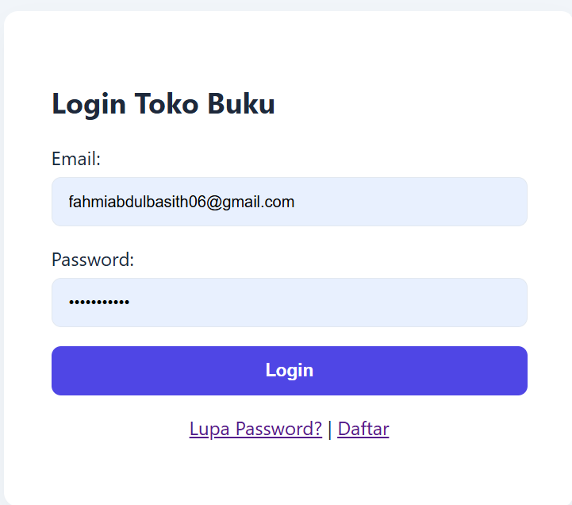
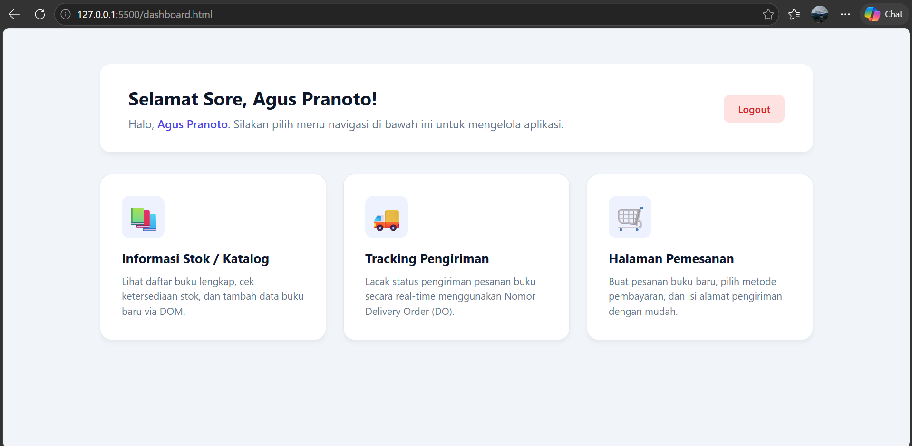
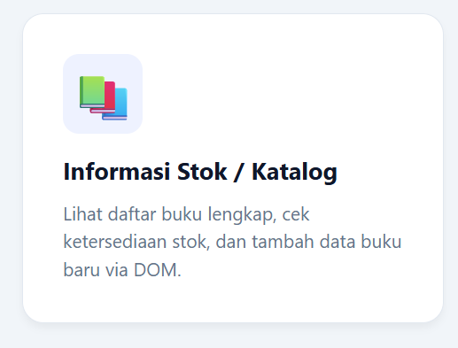
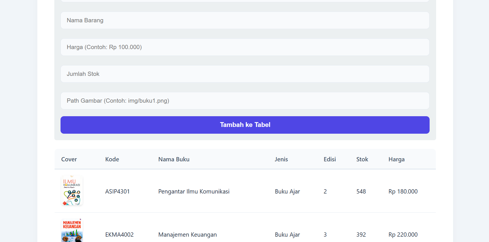
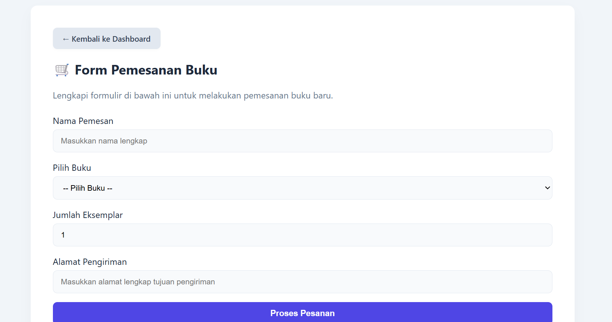
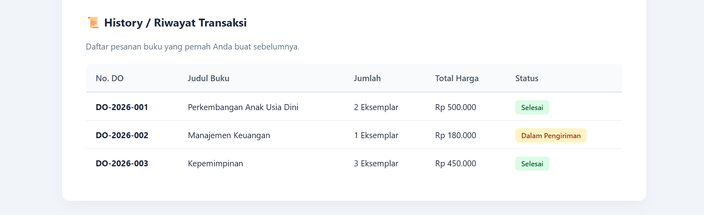
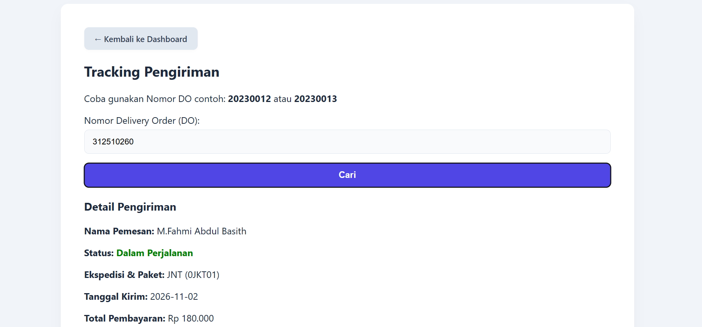

# Tugas UTS: Pemrograman Web 1 - Toko Buku Online

## Identitas Mahasiswa

* **Nama:** M. Fahmi Abdul Basith

* **NIM:** 312510260

* **Mata Kuliah:** Pemrograman Web 1

* **Topik:** Perancangan Front-End Aplikasi Pemesanan Buku Online (HTML, CSS, JS DOM, JSON Data, LocalStorage)

## A. Tujuan Tugas UTS

Berdasarkan indikator penilaian pada lembar soal UTS Pemrograman Web 1, tujuan kegiatan ini adalah:

1. Merancang struktur HTML yang semantik, valid, dan lengkap.

2. Mengelola gaya antar muka menggunakan CSS (*inline*, *internal*, *external*) dengan tema visual modern dan responsif.

3. Menggunakan JavaScript untuk manipulasi DOM, validasi form, manipulasi data tabel dinamis, serta interaksi UI seperti *pop-up*, *modal box*, dan *alert box*.

4. Mengimplementasikan data *dummy* berbasis variabel JavaScript dalam format Array JSON tanpa backend/server.

5. Membangun halaman website yang saling terintegrasi (Login, Dashboard, Stok/Katalog, Pemesanan, Tracking Pengiriman, dan History Transaksi).

## B. Struktur File Project

Seluruh berkas disimpan di dalam folder utama `tugas-uts-web1/` sesuai dengan struktur di Visual Studio Code berikut:

```
tugas-uts-web1/
├── assets/
├── css/
│   └── style.css
├── img/
│   ├── kepemimpinan.jpg
│   ├── manajemen_keuangan.jpg
│   ├── mikrobiologi.jpg
│   ├── paud_perkembangan.jpg
│   └── pengantar_komunikasi.jpg
├── js/
│   ├── data.js
│   └── script.js
├── chackout.html
├── dashboard.html
├── index.html
├── README.md
├── stok.html
└── tracking.html


```

* **`assets/`**: Folder opsional untuk menyimpan aset tambahan seperti logo.

* **`css/style.css`**: Styling utama aplikasi dengan tampilan UI modern, card layout, dan efek interaktif.

* **`img/`**: Penyimpanan gambar cover buku (.jpg).

* **`js/data.js`**: File JSON dummy berisi data pengguna, katalog buku, dan pelacakan DO.

* **`js/script.js`**: Script pembantu global/helper.

* **`index.html`**: Halaman login utama dan modal box dialog.

* **`dashboard.html`**: Halaman navigasi utama & ucapan salam waktu lokal.

* **`stok.html`**: Halaman katalog stok buku & penambahan baris DOM.

* **`chackout.html`**: Halaman formulir pemesanan buku.

* **`tracking.html`**: Halaman pelacakan status pengiriman DO.

* **`README.md`**: Dokumentasi laporan pengerjaan proyek UTS.

## C. Persiapan Praktikum

### Langkah 1 — Membuat Folder dan File di Visual Studio Code

1. Buat folder bernama `tugas-uts-web1`.

2. Di dalam folder tersebut, buat folder `assets/`, `css/`, `img/`, dan `js/`.

3. Buka VS Code, pilih **File → Open Folder...**, lalu buka folder `tugas-uts-web1`.

4. Buat file `index.html`, `dashboard.html`, `stok.html`, `chackout.html`, `tracking.html`, `css/style.css`, `js/data.js`, `js/script.js`, dan `README.md`.

5. Masukkan gambar cover buku ke dalam folder `img/`.

### Langkah 2 — Menghubungkan CSS dan JavaScript

Pada bagian `<head>` atau sebelum tag penutup `</body>` di setiap file HTML, sambungkan file stylesheet dan javascript:

```
<link rel="stylesheet" href="css/style.css">
<script src="js/data.js"></script>
<script src="js/script.js" defer></script>


```

## D. Cara Menjalankan Program

1. Simpan seluruh file dengan menekan **Ctrl + S** di VS Code.

2. Buka file `index.html` di browser (klik kanan `index.html` → **Open with Live Server**).

3. Gunakan akun demo berikut untuk login:

   * **Email:** `rina@gmail.com` | **Password:** `rina123`

   * **Email:** `agus@gmail.com` | **Password:** `agus123`

   * **Email:** `siti@gmail.com` | **Password:** `siti123`

4. Jelajahi 4 menu utama di **Dashboard** (Stok, Tracking, Pemesanan, History Transaksi), uji penambahan stok di `stok.html`, buat pesanan di `chackout.html`, dan lacak nomor DO (`20230012` atau `20230013`) di `tracking.html`.

5. Buka Developer Tools dengan menekan **F12** (tab Console) untuk memantau aktivitas script.

## E. Langkah Kerja, Penjelasan Kode & Screenshot Hasil

### Langkah 1 — Menyiapkan Data JSON Dummy (`js/data.js`)

**Tujuan:** Menyediakan data dummy berupa array objek JSON tanpa koneksi database server.

**Kode JavaScript (`js/data.js`):**

```
var dataPengguna = [
    { id: 1, nama: "Rina Wulandari", email: "rina@gmail.com", password: "rina123", role: "User" },
    { id: 2, nama: "Agus Pranoto", email: "agus@gmail.com", password: "agus123", role: "User" },
    { id: 3, nama: "Siti Marlina", email: "siti@gmail.com", password: "siti123", role: "Admin" }
];

var dataKatalogBuku = [
    { kodeBarang: "ASIP4301", namaBarang: "Pengantar Ilmu Komunikasi", jenisBarang: "Buku Ajar", edisi: "2", stok: 548, harga: "Rp 180.000", cover: "img/pengantar_komunikasi.jpg" },
    { kodeBarang: "EKMA4002", namaBarang: "Manajemen Keuangan", jenisBarang: "Buku Ajar", edisi: "3", stok: 392, harga: "Rp 220.000", cover: "img/manajemen_keuangan.jpg" },
    { kodeBarang: "EKMA4310", namaBarang: "Kepemimpinan", jenisBarang: "Buku Ajar", edisi: "1", stok: 278, harga: "Rp 150.000", cover: "img/kepemimpinan.jpg" },
    { kodeBarang: "BIOL4211", namaBarang: "Mikrobiologi Dasar", jenisBarang: "Buku Ajar", edisi: "2", stok: 165, harga: "Rp 200.000", cover: "img/mikrobiologi.jpg" },
    { kodeBarang: "PAUD4401", namaBarang: "Perkembangan Anak Usia Dini", jenisBarang: "Buku Ajar", edisi: "4", stok: 204, harga: "Rp 250.000", cover: "img/paud_perkembangan.jpg" }
];

var dataTracking = {
    "20230012": {
        nomorDO: "20230012",
        nama: "Rina Wulandari",
        status: "Dalam Perjalanan",
        ekspedisi: "JNE",
        tanggalKirim: "2025-08-25",
        paket: "0JKT01",
        total: "Rp 180.000",
        perjalanan: [
            { waktu: "2025-08-25 10:12:20", keterangan: "Penerimaan di Loket: TANGERANG SELATAN." },
            { waktu: "2025-08-25 14:07:56", keterangan: "Tiba di Hub: TANGERANG SELATAN" },
            { waktu: "2025-08-25 16:12:20", keterangan: "Diteruskan ke Kantor Jakarta Selatan" }
        ]
    },
    "20230013": {
        nomorDO: "20230013",
        nama: "Agus Pranoto",
        status: "Selesai",
        ekspedisi: "Pos Indonesia",
        tanggalKirim: "2025-08-25",
        paket: "0UPBJJBDG",
        total: "Rp 220.000",
        perjalanan: [
            { waktu: "2025-08-25 10:12:20", keterangan: "Penerimaan di Loket: TANGERANG SELATAN." },
            { waktu: "2025-08-26 20:00:00", keterangan: "Selesai Antar. Penerima: Agus Pranoto" }
        ]
    }
};


```

### Langkah 2 — Halaman Login & Modal Box (`index.html`)

**Tujuan:** Mengunci akses aplikasi, memvalidasi input email/password via JS, memberikan feedback alert saat gagal, dan menyediakan modal box untuk "Lupa Password" dan "Daftar".

**Kode HTML & JavaScript (`index.html`):**

```
<!DOCTYPE html>
<html lang="id">
<head>
    <meta charset="UTF-8">
    <title>Login - Toko Buku Online</title>
    <link rel="stylesheet" href="css/style.css">
</head>
<body>
    <div class="container" style="max-width: 400px;">
        <h2>Login Toko Buku</h2>
        <form id="formLogin">
            <label>Email:</label>
            <input type="email" id="email" required placeholder="Contoh: rina@gmail.com">
            
            <label>Password:</label>
            <input type="password" id="password" required placeholder="Contoh: rina123">
            
            <button type="submit">Login</button>
        </form>
        <p style="text-align: center;">
            <a href="#" onclick="bukaModal('modalLupa')">Lupa Password?</a> | 
            <a href="#" onclick="bukaModal('modalDaftar')">Daftar</a>
        </p>
    </div>

    <!-- Modal Box Lupa Password -->
    <div id="modalLupa" class="modal">
        <div class="modal-content">
            <span class="close" onclick="tutupModal('modalLupa')">&times;</span>
            <h3>Pemulihan Sandi</h3>
            <p>Silakan hubungi administrator untuk mereset sandi akun Anda.</p>
        </div>
    </div>

    <!-- Modal Box Daftar -->
    <div id="modalDaftar" class="modal">
        <div class="modal-content">
            <span class="close" onclick="tutupModal('modalDaftar')">&times;</span>
            <h3>Pendaftaran Akun</h3>
            <p>Gunakan akun demo yang tersedia di data (misal: rina@gmail.com / rina123).</p>
        </div>
    </div>

    <script src="js/data.js"></script>
    <script>
        document.getElementById('formLogin').addEventListener('submit', function(e) {
            e.preventDefault();
            let inputEmail = document.getElementById('email').value;
            let inputPass = document.getElementById('password').value;

            let user = dataPengguna.find(u => u.email === inputEmail && u.password === inputPass);
            if (user) {
                alert("Login Berhasil! Selamat datang " + user.nama);
                localStorage.setItem('currentUser', user.nama);
                window.location.href = 'dashboard.html';
            } else {
                alert("email/password yang anda masukkan salah");
            }
        });

        function bukaModal(id) { document.getElementById(id).style.display = 'block'; }
        function tutupModal(id) { document.getElementById(id).style.display = 'none'; }
    </script>
</body>
</html>


```

**Hasil Screenshot Halaman Login & Alert:**



**Hasil Screenshot Modal Box (Lupa Password / Daftar):**


### Langkah 3 — Halaman Dashboard Menu (`dashboard.html`)

**Tujuan:** Menampilkan 4 kartu navigasi menu utama (Informasi Stok, Tracking Pengiriman, Pemesanan, History Transaksi, serta tombol Logout) dan pesan *greeting* dinamis berdasarkan waktu lokal pengguna.

**Kode HTML & JavaScript (`dashboard.html`):**

```
<!DOCTYPE html>
<html lang="id">
<head>
    <meta charset="UTF-8">
    <title>Dashboard - Toko Buku Online</title>
    <link rel="stylesheet" href="css/style.css">
</head>
<body>
    <div class="dashboard-container">
        <!-- Header Sambutan -->
        <div class="dashboard-header">
            <div>
                <h2 id="greeting">Selamat Datang</h2>
                <p>Halo, <span id="namaUser" style="font-weight: 600; color: #4f46e5;">User</span>. Silakan pilih menu navigasi di bawah ini untuk mengelola aplikasi.</p>
            </div>
            <div>
                <a href="index.html" class="btn-logout">Logout</a>
            </div>
        </div>

        <!-- Grid Kartu Menu Navigasi (4 Kartu) -->
        <div class="menu-grid">
            <a href="stok.html" class="menu-card">
                <div class="card-icon">📚</div>
                <h3>Informasi Stok / Katalog</h3>
                <p>Lihat daftar buku lengkap, cek ketersediaan stok, dan tambah data buku baru via DOM.</p>
            </a>

            <a href="tracking.html" class="menu-card">
                <div class="card-icon">🚚</div>
                <h3>Tracking Pengiriman</h3>
                <p>Lacak status pengiriman pesanan buku secara real-time menggunakan Nomor Delivery Order (DO).</p>
            </a>

            <a href="chackout.html" class="menu-card">
                <div class="card-icon">🛒</div>
                <h3>Halaman Pemesanan</h3>
                <p>Buat pesanan buku baru, pilih metode pembayaran, dan isi alamat pengiriman dengan mudah.</p>
            </a>

            <a href="#" class="menu-card" onclick="alert('Fitur History Transaksi sedang dalam pengembangan.'); return false;">
                <div class="card-icon">📜</div>
                <h3>History Transaksi</h3>
                <p>Lihat riwayat pembelian dan status transaksi pemesanan buku yang pernah Anda lakukan.</p>
            </a>
        </div>
    </div>

    <script>
        let user = localStorage.getItem('currentUser') || 'Tamu';
        document.getElementById('namaUser').innerText = user;

        let jam = new Date().getHours();
        let ucapan = "Pagi";
        if (jam >= 11 && jam < 15) {
            ucapan = "Siang";
        } else if (jam >= 15 && jam < 18) {
            ucapan = "Sore";
        } else if (jam >= 18) {
            ucapan = "Malam";
        }
        document.getElementById('greeting').innerText = `Selamat ${ucapan}, ${user}!`;
    </script>
</body>
</html>


```

**Pembahasan Fitur Dashboard:**

1. **Greeting Dinamis Waktu Lokal:** JavaScript membaca waktu dengan `new Date().getHours()` dan menentukan ucapan Pagi/Siang/Sore/Malam secara otomatis.

2. **Navigasi Card Layout (4 Kartu Menu):** Menampilkan pilihan menu (Stok, Tracking, Pemesanan, History Transaksi) secara visual dengan gaya grid yang responsif, emoji ikon, serta efek melayang (*hover*) CSS.

**Hasil Screenshot Dashboard Menu & Local Time Greeting:**




### Langkah 4 — Halaman Informasi Stok / Katalog Buku (`stok.html`)

**Tujuan:** Menampilkan data dummy katalog dari `dataKatalogBuku` secara dinamis ke tabel HTML serta menyediakan fitur penambahan baris stok baru menggunakan JavaScript DOM (`createElement` & `appendChild`).

**Kode HTML & JavaScript (`stok.html`):**

```
<!DOCTYPE html>
<html lang="id">
<head>
    <meta charset="UTF-8">
    <title>Informasi Stok & Katalog Buku</title>
    <link rel="stylesheet" href="css/style.css">
</head>
<body>
    <div class="container">
        <div class="nav-links">
            <a href="dashboard.html">&larr; Kembali ke Dashboard</a>
        </div>
        <h2>Informasi Stok / Katalog Buku</h2>
        
        <!-- Form Tambah Stok via DOM -->
        <div style="background: #ecf0f1; padding: 15px; border-radius: 8px; margin-bottom: 20px;">
            <h3>Tambah Baris Stok Baru (DOM)</h3>
            <input type="text" id="kode" placeholder="Kode Barang (Contoh: TI101)">
            <input type="text" id="nama" placeholder="Nama Barang">
            <input type="text" id="harga" placeholder="Harga (Contoh: Rp 100.000)">
            <input type="number" id="stok" placeholder="Jumlah Stok">
            <input type="text" id="cover" placeholder="Path Gambar (Contoh: img/pengantar_komunikasi.jpg)">
            <button type="button" onclick="tambahStokBaru()">Tambah ke Tabel</button>
        </div>

        <table>
            <thead>
                <tr>
                    <th>Cover</th>
                    <th>Kode</th>
                    <th>Nama Buku</th>
                    <th>Jenis</th>
                    <th>Edisi</th>
                    <th>Stok</th>
                    <th>Harga</th>
                </tr>
            </thead>
            <tbody id="bodyKatalog"></tbody>
        </table>
    </div>

    <script src="js/data.js"></script>
    <script>
        function muatKatalog() {
            let tbody = document.getElementById('bodyKatalog');
            tbody.innerHTML = "";
            dataKatalogBuku.forEach(buku => {
                tbody.innerHTML += `<tr>
                    <td></td>
                    <td>${buku.kodeBarang}</td>
                    <td>${buku.namaBarang}</td>
                    <td>${buku.jenisBarang}</td>
                    <td>${buku.edisi}</td>
                    <td>${buku.stok}</td>
                    <td>${buku.harga}</td>
                </tr>`;
            });
        }

        function tambahStokBaru() {
            let kode = document.getElementById('kode').value;
            let nama = document.getElementById('nama').value;
            let harga = document.getElementById('harga').value;
            let stok = document.getElementById('stok').value;
            let cover = document.getElementById('cover').value || 'https://via.placeholder.com/50x70?text=No+Img';

            if(!kode || !nama || !harga || !stok) {
                alert("Semua kolom utama wajib diisi!");
                return;
            }

            let tbody = document.getElementById('bodyKatalog');
            let newRow = document.createElement('tr');
            newRow.innerHTML = `
                <td></td>
                <td>${kode}</td>
                <td>${nama}</td>
                <td>Buku Baru</td>
                <td>1</td>
                <td>${stok}</td>
                <td>${harga}</td>
            `;
            tbody.appendChild(newRow);

            document.getElementById('kode').value = '';
            document.getElementById('nama').value = '';
            document.getElementById('harga').value = '';
            document.getElementById('stok').value = '';
            document.getElementById('cover').value = '';
            alert("Baris stok baru berhasil ditambahkan!");
        }

        window.onload = muatKatalog;
    </script>
</body>
</html>


```

**Hasil Screenshot Halaman Stok & Katalog Buku:**



**Hasil Screenshot Tambah Baris Stok Baru via JS DOM:**



### Langkah 5 — Halaman Pemesanan (`chackout.html`)

**Tujuan:** Menyediakan formulir checkout transaksi pemesanan buku, pemilihan metode pembayaran, serta konfirmasi rincian pesanan.

**Kode HTML & JavaScript (`chackout.html`):**

```
<!DOCTYPE html>
<html lang="id">
<head>
    <meta charset="UTF-8">
    <title>Halaman Pemesanan</title>
    <link rel="stylesheet" href="css/style.css">
</head>
<body>
    <div class="container">
        <div class="nav-links">
            <a href="dashboard.html">&larr; Kembali ke Dashboard</a>
        </div>
        <h2>Formulir Pemesanan Buku</h2>
        
        <form id="formCheckout">
            <label>Nama Pemesan:</label>
            <input type="text" id="pemesan" value="Rina Wulandari" required>

            <label>Pilih Buku:</label>
            <select id="pilihanBuku">
                <option value="Pengantar Ilmu Komunikasi">Pengantar Ilmu Komunikasi - Rp 180.000</option>
                <option value="Manajemen Keuangan">Manajemen Keuangan - Rp 220.000</option>
                <option value="Kepemimpinan">Kepemimpinan - Rp 150.000</option>
            </select>

            <label>Jumlah Pesanan:</label>
            <input type="number" id="jumlah" value="1" min="1" required>

            <label>Alamat Pengiriman:</label>
            <input type="text" id="alamat" placeholder="Masukkan alamat lengkap" required>

            <label>Metode Pembayaran:</label>
            <select id="pembayaran">
                <option value="Transfer Bank">Transfer Bank</option>
                <option value="COD">COD (Bayar di Tempat)</option>
                <option value="E-Wallet">E-Wallet (DANA/OVO)</option>
            </select>

            <button type="button" onclick="prosesPesan()">Proses Pemesanan</button>
        </form>

        <div id="ringkasanPesanan" style="margin-top: 20px; display:none; background: #e8f8f5; padding: 15px; border-radius: 8px;">
            <h3>Rincian Pemesanan:</h3>
            <p id="hasilPesanan"></p>
        </div>
    </div>

    <script>
        function prosesPesan() {
            let pemesan = document.getElementById('pemesan').value;
            let buku = document.getElementById('pilihanBuku').value;
            let jumlah = document.getElementById('jumlah').value;
            let alamat = document.getElementById('alamat').value;
            let pembayaran = document.getElementById('pembayaran').value;

            if(!alamat) {
                alert("Alamat pengiriman wajib diisi!");
                return;
            }

            let teks = `Terima kasih <b>${pemesan}</b>. Anda berhasil memesan buku <b>${buku}</b> sebanyak <b>${jumlah} pcs</b>.<br>` +
                       `Alamat Tujuan: ${alamat}<br>Pembayaran via: ${pembayaran}.<br>` +
                       `Status: <span style="color:green;">Pesanan Berhasil Diproses!</span>`;
            
            document.getElementById('hasilPesanan').innerHTML = teks;
            document.getElementById('ringkasanPesanan').style.display = 'block';
        }
    </script>
</body>
</html>


```

**Hasil Screenshot Form Pemesanan & Ringkasan Transaksi:**




### Langkah 6 — Halaman Tracking Pengiriman (`tracking.html`)

**Tujuan:** Melakukan pencarian status paket berdasarkan Nomor Delivery Order (DO) dari objek `dataTracking` dan menyajikan histori perjalanan paket.

**Kode HTML & JavaScript (`tracking.html`):**

```
<!DOCTYPE html>
<html lang="id">
<head>
    <meta charset="UTF-8">
    <title>Tracking Pengiriman</title>
    <link rel="stylesheet" href="css/style.css">
</head>
<body>
    <div class="container">
        <div class="nav-links">
            <a href="dashboard.html">&larr; Kembali ke Dashboard</a>
        </div>
        <h2>Tracking Pengiriman</h2>
        <p>Coba gunakan Nomor DO contoh: <b>20230012</b> atau <b>20230013</b></p>

        <label>Nomor Delivery Order (DO):</label>
        <input type="text" id="inputDO" placeholder="Masukkan Nomor DO...">
        <button type="button" onclick="cariTracking()">Cari</button>

        <div id="hasilTracking" style="margin-top: 20px; display: none;">
            <h3>Detail Pengiriman</h3>
            <p><strong>Nama Pemesan:</strong> <span id="tNama"></span></p>
            <p><strong>Status:</strong> <span id="tStatus" style="color: green; font-weight: bold;"></span></p>
            <p><strong>Ekspedisi & Paket:</strong> <span id="tEkspedisi"></span> (<span id="tPaket"></span>)</p>
            <p><strong>Tanggal Kirim:</strong> <span id="tTanggal"></span></p>
            <p><strong>Total Pembayaran:</strong> <span id="tTotal"></span></p>

            <h4>Riwayat Perjalanan:</h4>
            <table>
                <thead>
                    <tr><th>Waktu</th><th>Keterangan</th></tr>
                </thead>
                <tbody id="tRiwayat"></tbody>
            </table>
        </div>
    </div>

    <script src="js/data.js"></script>
    <script>
        function cariTracking() {
            let noDO = document.getElementById('inputDO').value.trim();
            let data = dataTracking[noDO];
            let containerHasil = document.getElementById('hasilTracking');

            if (data) {
                document.getElementById('tNama').innerText = data.nama;
                document.getElementById('tStatus').innerText = data.status;
                document.getElementById('tEkspedisi').innerText = data.ekspedisi;
                document.getElementById('tPaket').innerText = data.paket;
                document.getElementById('tTanggal').innerText = data.tanggalKirim;
                document.getElementById('tTotal').innerText = data.total;

                let tbody = document.getElementById('tRiwayat');
                tbody.innerHTML = "";
                data.perjalanan.forEach(item => {
                    tbody.innerHTML += `<tr><td>${item.waktu}</td><td>${item.keterangan}</td></tr>`;
                });

                containerHasil.style.display = 'block';
            } else {
                alert("Nomor Delivery Order (DO) tidak ditemukan!");
                containerHasil.style.display = 'none';
            }
        }
    </script>
</body>
</html>


```

**Hasil Screenshot Pencarian Tracking Nomor DO:**



## F. Pengujian dan Hasil

Daftar centang pengujian fitur aplikasi web:

* \[x\] **Validasi Form Login:** Menampilkan alert error jika email/password salah.

* \[x\] **Modal Dialog:** Pop-up modal *Lupa Password* dan *Daftar* berfungsi dengan baik.

* \[x\] **Dynamic Greeting Dashboard:** Menampilkan kata ucapan sesuai jam sistem komputer.

* \[x\] **Dashboard Cards:** Menampilkan 4 menu utama (Stok, Tracking, Pemesanan, History Transaksi) dalam layout grid responsif.

* \[x\] **Dynamic Table Render:** Memuat katalog data dummy JSON beserta cover buku.

* \[x\] **JS DOM Insertion:** Menambahkan baris stok baru ke tabel secara interaktif.

* \[x\] **Form Checkout:** Validasi input alamat dan penampilan rincian transaksi.

* \[x\] **Tracking Search:** Pencarian Nomor DO `20230012` & `20230013` menampilkan detail dan riwayat perjalanan paket.

## G. Pertanyaan Evaluasi

1. **Bagaimana data array JSON pada `data.js` diakses oleh file HTML tanpa server?**
   Data diakses dengan memasukkan script `<script src="js/data.js"></script>` di HTML sebelum file script pendukung dipanggil, sehingga variabel bertipe global otomatis tersimpan di scope `window` browser.

2. **Bagaimana cara kerja penambahan baris tabel pada `stok.html` secara dinamis?**
   Menggunakan fungsi JavaScript DOM `document.createElement('tr')` untuk membuat elemen baris baru, mengisi HTML sel-selnya, lalu memasukkannya ke elemen `<tbody>` menggunakan `appendChild()`.

3. **Bagaimana cara menentukan kata ucapan selamat secara otomatis pada dashboard?**
   Menggunakan objek waktu JavaScript `new Date().getHours()` untuk mendeteksi jam lokal sistem, lalu melakukan pengkondisian percabangan `if...else` untuk menetapkan kata Pagi, Siang, Sore, atau Malam.

## H. Kesimpulan

Proyek UTS Pemrograman Web 1 ini berhasil menyelesaikan seluruh kriteria indikator penilaian yang dipersyaratkan. Aplikasi web Toko Buku Online front-end ini mampu mengelola struktur HTML yang valid, gaya CSS yang modern dan responsif, serta manipulasi JavaScript DOM yang interaktif mulai dari autentikasi login, ucapan salam dinamis, pengelolaan 4 menu utama dashboard (Stok, Tracking, Pemesanan, History Transaksi), hingga pelacakan paket pengiriman secara real-time.